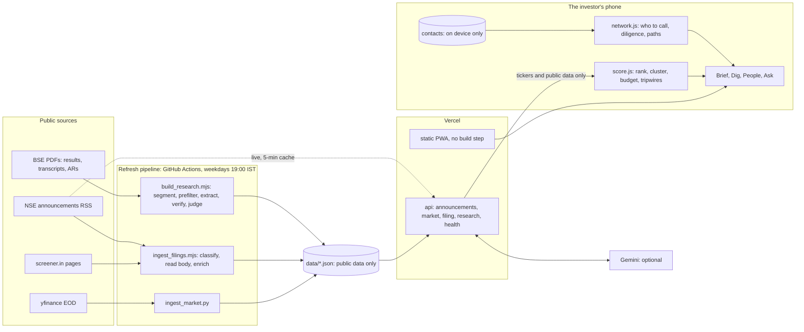

# FINN

**What matters in your portfolio today, whether management keeps its word, and who in your own network can explain it, without your network ever leaving your phone.**

A mobile-first investing agent built for the ENAM Founding AI Engineer Build Challenge. It is a PWA on Vercel: open it on a phone. It runs end to end with **no API key**, and a Gemini key upgrades it (see [Adding the AI key](#adding-the-ai-key-later)).

**New device?** Follow [Run it on a new device](#run-it-on-a-new-device-step-by-step): install Node, then `npm install` and `npm run dev`.

---

## The point of view

Most "AI for investors" products show you more. FINN is built on the opposite premise: an investor's scarcest resource is attention, and their real edge is the people they know. Three ideas shape it.

### 1. Attention is the budget, not the data (Push)
The Brief opens with one sentence: *"Three things worth your 3 minutes. Two involve people you know."*

- **You set the time** (1–10 min). FINN packs the most material stories into that budget, knapsack-style, and never splits a story. Anything that doesn't fit is counted ("4 more beyond your budget → *Make time*") rather than silently dropped.
- **Ranking:** `filing type × position size × the market's reaction × your network × what you've buried`.
  - Filing type is a rule-based classifier that maps exchange subjects (and the PDF body, when the subject is boilerplate) onto the reference document's categories.
  - Market reaction is the stock's move net of Nifty, plus volume against its 20-day average.
- **Stories, not filings:** the three filings a company puts out around one board meeting (results, the press release, the JV) collapse into one card.
- **The floor:** 55 of 90 filings in the last 30 days were routine (trading-window closures, investor-meet schedules, compliance certificates). They are buried, not deleted, one tap away and grouped by type.
- **Gestures:**
  - Swipe left to bury a story. Bury the same kind three times and FINN learns to rank it lower.
  - Swipe right, or tap *Dial*, to see who you could call about it.
- **Tripwires:** you decide what "unusual" means (±% move, × volume, net of market, which filing types interrupt you). FINN replays your thresholds over the last 30 sessions, *"55 alerts ≈ 9/week — that's noisy"*, before you commit to them.
- **Audio brief:** a tap reads the brief aloud for the commute (Web Speech).

### 2. Models read, code decides (Pull)
**Dig** builds a dossier on any NSE ticker, grounded only in primary sources: exchange-filed results, annual reports and concall transcripts.

- **Facts and trajectory:** every figure (growth, margins, debt/equity, working-capital days, 5-year cash conversion) is computed in code from filed numbers.
- **The Promise Ledger:** FINN reads the last six earnings calls, extracts every quantified promise management made, and checks each one against what they later reported:
  - Every quote is **machine-verified word-for-word against the transcript PDF**, with a page link (the *receipt*). A quote that can't be found is dropped.
  - Verdicts are computed, not generated: *kept · nearly · missed · goalposts moved · tracking ahead/behind · no deadline*.
  - *Goalposts moved* catches a target that was quietly cut before it fell due. Kaynes guided "₹4,500 cr+" for FY26 in Aug 2025, cut it to "₹4,000 cr" in Feb 2026, and reported ₹3,626 cr.
  - A **Say/Do score** summarises the record, and a drift chart shows the restatements.
- **Narrative vs numbers, bull/bear, questions for the next call:**
  - With a key, Gemini writes these, but only from a numbered fact sheet (F1–F12) and the ledger (C1…). Any point that doesn't cite a fact is dropped.
  - Without a key, a deterministic rule-based analyst writes them.
- **Pipeline transparency:** each dossier shows its cost, e.g. *"Read 6 calls (332K chars) → kept 12.9K (96% cut before any model) → 11 promises → 11/11 quotes verified → judged in code."*

### 3. The network is the edge, and it stays private (Network)
When a filing names a person, such as a new MD & CEO, FINN runs **network diligence** on the phone:

- *"Rohan overlapped with Anup Bagchi at ICICI Securities, 2012–2016, when Anup was MD & CEO."*
- *"You're both IIT Kanpur alumni."*
- *One hop:* *"Rohan, Karthik and Arvind know Anup Bagchi (HDFC Bank), a colleague of Sanjay's"*, so even a retiring group head has a warm path.
- **Who to call:** for any event, contacts are ranked by how close they are to *it* (worked there, at the JV partner, competitor or regulator, *lived through the same kind of event*, knows the person named in the filing) × how close they are to *you* (tie strength, how long since you spoke). Every suggestion comes with its reasons and a drafted opener you can send on WhatsApp or copy. For example, on CG Power's Waluj plant-closure order, FINN puts first the ex-Waluj plant head who lived through an earlier closure order, then the environmental lawyer who won a High Court stay on one, then a retired pollution-board officer.
- **Your book, through your people:** a constellation of holdings and the contacts who can speak to them, with blind spots outlined.
- **Keep warm:** *"Amol worked at Persistent 2003–2022 and you haven't spoken in 20 months — Persistent just raised ₹4,265 cr."* A real reason to reconnect, with the message drafted.
- **Ask FINN** (text or voice): *"who knows rural lending?"*, *"path to Raghu Panicker"*, *"brief me on Anup Bagchi"*, *"research PIIND"*. This is parsed **on the device** by a small intent grammar, deliberately not an LLM, so questions about people never leave the phone.

---

## Try it in 60 seconds
1. **Brief** (24h): the Kaynes story. Tap **Dial** to see who to call; the top contact runs a competing OSAT line.
2. Switch to **30D**. Open the **HDFC Bank / Anup Bagchi** card to see the career timeline, the contacts whose careers overlapped with Bagchi's, and a drafted message.
3. **Dig → KAYNES**, then scroll to *Promises vs delivery*: the Say/Do ring, the goalposts that moved, and verified quotes with page receipts.
4. **People:** the constellation, the expertise map, and *Bring your own network* (LinkedIn CSV import, parsed on the phone).
5. **Tripwires** (tab bar): drag the sliders and watch the 30-session backtest change.

---

## Real vs synthetic: what this prototype uses

| Data | Real or synthetic | Source |
|---|---|---|
| Filings, results, transcripts, annual reports | **Real** | BSE/NSE disclosures via screener.in company pages and NSE's public announcements RSS; PDFs from BSE |
| Prices and volumes | **Real** | Yahoo Finance EOD via `yfinance` |
| People named in filings (Anup Bagchi, Leo Puri, Gaurav Gupta, Raghu Panicker…) | **Real public figures** | Role and dates from the filing itself; career history summarised at build time from public professional records, with the source shown on every profile |
| The investor ("You") and all 38 contacts | **Synthetic** | Fictional people with realistic careers at real companies, built to exercise the matching (`public/demo/network.json`). Five organisations are fictional and labelled as such. |
| Portfolio (18 holdings, weights) | Illustrative | `data/portfolio.json` |

**How I'd do it for real:** the network comes only from sources the investor owns and consents to:
- their LinkedIn *Connections* export (this already works: People → *Bring your own network*);
- phone contacts and calendar or email metadata via OAuth with minimal scopes;
- their CRM.

The investor adds the context that matters ("ran the Waluj plant", "knows Anup from ICICI"). No scraping of LinkedIn or any platform whose terms prohibit it. Filing subjects are enriched only with professional, public-record facts, never contact details.

---

## Architecture



### Data pipelines
- **Market:** `scripts/ingest_market.py` pulls 130 sessions of EOD close and volume for 18 holdings plus Nifty into `data/market.json`. Tripwires, reaction-to-filing and backtests are computed on the phone from this one file.
- **Filings:**
  - `scripts/ingest_filings.mjs` pulls each company's announcements (with BSE PDF links and screener's notes) and merges NSE's public RSS. The API also polls the RSS live, cached for 5 minutes, so the Brief catches filings made since the last refresh.
  - The classifier (`lib/classify.js`) is an ordered rule set: noise rules first, then specific events. It works on the subject and, when the subject is boilerplate ("Announcement under Regulation 30"), on the PDF body from "Sub:" onwards. Container filings (postal ballot outcomes, AGM results) are upgraded by what they contain: a postal ballot approving a new MD & CEO is a management change.
  - Re-classification is offline and takes microseconds, so rule fixes apply to history.
- **Fundamentals:** screener's standardised tables are turned by `lib/fundamentals.js` into the headline numbers, the dossier facts and an *actuals index* (FY and quarterly) that the ledger judges against. Bank and NBFC P&Ls are handled separately (PPOP instead of EBITDA).
- **Freshness guard:** a results filing is only paired with numbers for *the quarter it reports*. Screener can lag a fresh filing by a day; Kaynes filed its Sep-2026 results yesterday, so FINN says the numbers are filed but not yet standardised, rather than showing June's. This was caught while testing on a phone emulator.
- **Transcripts to Promise Ledger** (`lib/guidance.js`, `lib/ledger.js`):
  1. Parse the PDF with `unpdf`.
  2. Segment speaker turns and separate management from analysts.
  3. Keep only forward-looking management sentences, which removes **95–97% of the text before any model sees it**.
  4. Extract claims (build-time seed, Gemini Flash-Lite, or a regex heuristic).
  5. `verifyQuote` (exact, or ≥90% fuzzy) against the full text.
  6. Judge against the actuals index as of today.
- **Entity resolution:** a 120-organisation dictionary (`public/demo/orgs.json`) holds aliases, NSE symbols, theme tags and typed relations (competitor, JV partner, regulator, subsidiary).
  - Names are matched with honorifics stripped, on surname plus first initial.
  - Career overlap is interval intersection.
  - A filing gets `orgs` and `eventTags` (e.g. `regulatory shutdown`, `pollution board`), and these are matched against each contact's career and *lived-through* events.

### Data security & privacy
- **The network never leaves the device.**
  - `network.js` runs in the browser. The server's endpoints accept tickers, never contact names, and the server stores no personal data about the investor or their contacts.
  - Today the network is in `localStorage`. In production it would be an IndexedDB vault encrypted with a WebCrypto key unlocked by a passkey or biometrics, synced (if at all) end-to-end encrypted with a key only the user holds.
- **What is stored, and for how long:**
  - Server side, only public market and filing data. Filing caches roll off after 30–90 days.
  - On the device, the network until the user deletes it ("Reset" is one tap).
  - No accounts, no analytics, no third-party trackers.
- **LLMs and personal data:**
  - Only *public* filing text is ever sent to a model, e.g. to extract the incoming CEO's name and role.
  - The private network is never sent. If a model ever needs to reason over contacts, it would run on-device or see pseudonymised tokens (`P17 worked at ORG4 2012–16`), re-identified locally.
- **Consent and access control (real deployment):**
  - Each source is imported with explicit, revocable consent; revoking deletes the derived data.
  - Single-user vault by default. Sharing a contact with a colleague is an explicit per-card action, never a team-wide index.
  - Profiles of people named in filings are limited to public, professional facts, with the source cited and a correction path.
- **Secrets:** the model key lives only in server env vars (Vercel, or `.env.local`, which is gitignored); the browser never sees it.

### LLMs and agents: the right tool for each step

| Step | Default (no key) | With `GEMINI_API_KEY` | Why |
|---|---|---|---|
| Filing classification | Rules (`lib/classify.js`) | Rules (deterministic, free) | 90% of filings are recognisable from the subject; rules are auditable |
| Filing one-liners | Build-time enrichment | `gemini-3.5-flash`, batches of 12 per call | Needs judgment on messy PDFs; batching cuts calls 12× |
| People in filings | Build-time enrichment | `gemini-3.5-flash` on demand, per filing | Only when a sheet is opened |
| Guidance extraction | Build-time seed / regex heuristic | `gemini-3.5-flash-lite` on the prefiltered 3–5% | Bulk, structured, cheapest tier |
| Synthesis (bull/bear) | Rule-based analyst | `gemini-3.5-flash` with a thinking budget, cite-or-drop | The only step that reasons |
| Ask FINN | On-device intent grammar | On-device (by design) | Privacy over cleverness |

- Every call returns JSON-schema-constrained output at temperature ≤0.2.
- Responses are cached by `hash(model + prompt)`, in memory or, optionally, in Upstash Redis shared across serverless instances.
- A new ticker's ledger costs one Flash-Lite call per transcript on a few thousand tokens. The whole system runs comfortably on the free tier.
- **Build-time agents:** while building, I used Claude Code subagents to
  - extract the seed guidance claims for the four research names;
  - write the one-liners and public-record career summaries for the 17 material filings;
  - generate the synthetic network.

  Agent output is treated like model output at runtime: **verified, not trusted**. Every seeded quote passed `verifyQuote` against its PDF (0 dropped), and the network was cross-checked for referential integrity (every org resolves, every relation symbol exists).

### Cloud
- **Vercel:** static `public/` plus Node functions in `api/` (Web-standard `GET`/`POST`). `data/**` is bundled into the functions.
- **GitHub Actions** (`.github/workflows/refresh.yml`): refreshes market data, filings and research on weekday evenings, runs the tests, and commits. The commit triggers a redeploy.
- **Optional Upstash Redis:** a cache shared across instances.
- **Zero-build frontend:** Preact and htm are vendored (~15 KB), with no bundler and no framework install. The repo is ~1.3 MB without `node_modules`, and production dependencies are two small packages (`unpdf`, `node-html-parser`).

---

## What I deliberately left out
- **Real push notifications.** Tripwires and the Brief are computed on open. Next step: Web Push (VAPID) fired by the refresh job.
- **Accounts, sync and the encrypted vault** (designed above, not built).
- **NSE/BSE private APIs.** NSE's JSON API needs a browser session cookie and BSE's API sits behind bot protection. I used only public pages, the public RSS and the PDFs, in line with the platforms' terms. Screener shows only the latest few announcements per company, so the 30-day view can be partial for very active companies; the NSE RSS fills recent gaps.
- **A general chat over everything.** Ask is a narrow, on-device grammar on purpose (see privacy). A cloud chat over *public* data is easy to add; a cloud chat over your contacts shouldn't exist.
- **Intraday prices, peer screens, valuation models.** They are out of scope for "what changed and who can explain it".

## Where I'd take it next
1. **Parse results PDFs on the day**, so the pending-quarter gap closes in minutes, not days.
2. **Ledger alerts:** push *"Management just restated FY27 guidance lower (goalposts moved)"* the moment a transcript lands, across the whole book.
3. **Guidance credibility across peers:** whose Say/Do score is best in specialty chemicals?
4. **The vault:** passkey-encrypted network, Google/phone-contact import, and interaction history (with consent) to learn tie strength instead of asking for it.
5. **Meeting prep:** before a management meeting, one page of their promises, your network's read on them, and the three questions to ask.

---

## Run it on a new device (step by step)

You need about 10 MB of disk and an internet connection for the first install. No API key, database or Python is needed to run FINN.

**1. Install Node.js 20 or newer** (the LTS version is fine):

| OS | How |
|---|---|
| macOS | Download the installer from [nodejs.org](https://nodejs.org), or `brew install node` |
| Windows | Download the installer from [nodejs.org](https://nodejs.org), or `winget install OpenJS.NodeJS.LTS` |
| Linux | [nodejs.org](https://nodejs.org/en/download) (or `nvm install --lts`) |

Check it worked by opening a **new** terminal and running `node -v`, which should print `v20` or higher.

**2. Get the code.** Unzip `FINN_submission.zip`, or `git clone` the repository. Then open a terminal inside the `finn` folder:
```bash
cd path/to/finn
```

**3. Install and start:**
```bash
npm install      # ~4 MB: two small packages (unpdf, node-html-parser)
npm run dev      # starts FINN on http://localhost:3000
```
- **On the computer:** open **http://localhost:3000**. FINN is built for phones, so narrow the window or use your browser's device toolbar (F12 → phone icon).
- **On your phone:** connect it to the same Wi-Fi and open the `On your phone →` address that `npm run dev` prints (e.g. `http://192.168.1.20:3000`). If your OS asks whether Node may accept network connections, allow it.
- **To stop the server:** press `Ctrl + C` in the terminal.

**4. (Optional) Run the tests:** `npm test` should report 10 passing tests.

**5. (Optional) Switch on live AI:** see [Adding the AI key later](#adding-the-ai-key-later) below. It is one line in a `.env.local` file.

**6. (Optional) Refresh the data.** The bundled data is a snapshot as of 15 Nov 2026, and the app's "now" is that snapshot's time. To pull fresh filings and prices you need Python 3.10+:
```bash
pip install yfinance
npm run refresh          # prices → filings → research; takes a few minutes
```
On Windows, if `python3` isn't found, run the three steps yourself: `python scripts/ingest_market.py`, then `npm run ingest:filings`, then `npm run build:research`.

**7. (Optional) Put it online:** push the folder to a GitHub repository, then import it at [vercel.com/new](https://vercel.com/new) and click Deploy. No settings are needed, because `vercel.json` covers them.

**If something goes wrong**

| Problem | Fix |
|---|---|
| `node` / `npm` not recognised | Close and reopen the terminal after installing Node (on Windows, sometimes sign out and in) |
| `EADDRINUSE` (port 3000 busy) | macOS/Linux: `PORT=3001 npm run dev`. Windows PowerShell: `$env:PORT=3001; npm run dev` |
| The phone can't open the page | It must be on the same Wi-Fi as the computer; allow Node through the firewall; use the printed `http://…:3000` address, not `localhost` |
| Blank page or an old version | Hard-refresh (Ctrl/Cmd + Shift + R). The app caches itself for offline use |
| `npm install` fails behind a proxy | `npm config set proxy http://…` or use another network; only two packages are fetched |

### Adding the AI key later
FINN is complete without a key. To switch on live AI (filing summaries, people extraction, guidance extraction for any ticker, and the written synthesis):
- **Locally:** `cp .env.example .env.local`, set `GEMINI_API_KEY=…`, restart `npm run dev`.
- **On Vercel:** Project → Settings → Environment Variables → `GEMINI_API_KEY` → Redeploy.
- **For the nightly refresh:** add the same key as a GitHub Actions secret.

Get a free key at Google AI Studio. Model tiers can be overridden with `GEMINI_MODEL_FAST`, `GEMINI_MODEL` and `GEMINI_MODEL_DEEP`.

## Repository map
```
api/            Vercel functions: announcements (Push feed + live NSE RSS), research (facts → ledger → synthesis), filing, market, health
lib/            classify · fundamentals · guidance (transcripts) · ledger (verdicts) · research · llm (router + cache) · screener · pdf · nse_rss
scripts/        ingest_market.py · ingest_filings.mjs · build_research.mjs · reclassify.mjs
data/           portfolio, market, filings, company facts, research dossiers, enrichment (public data only)
public/         the PWA — js/score.js (ranking), js/network.js (on-device network engine), js/views/*, demo/ (synthetic network + org graph)
tests/          node --test, zero dependencies
```

## How this was built
FINN was built with **Claude Code** in one long session, plus three background subagents for research seeding, enrichment and the synthetic network. A condensed build transcript, with the prompts that steered the build and what each step produced, is in [`docs/AI_BUILD_HISTORY.md`](docs/AI_BUILD_HISTORY.md). Notable course-corrections:
- Dropped Next.js for a zero-build Preact PWA to keep the footprint tiny.
- Abandoned NSE's cookie-gated API and BSE's API for public RSS, pages and PDFs.
- A unit test caught tie strength outranking relevance in who-to-call.
- The phone emulator caught a stale-quarter pairing on a results card.
